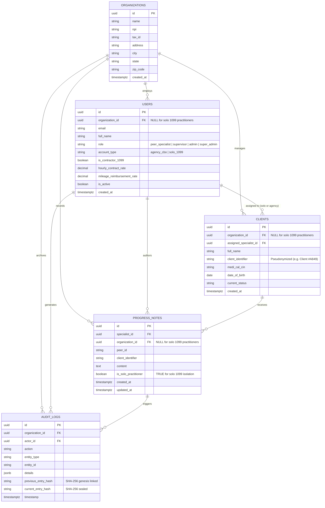

# Peer Notebook - Database ERD & Data Dictionary (Supabase / Dexie.js)
**Document ID:** DOC-04-03 • **ISO 9001:2015 Compliant** • **CalAIM & Medi-Cal H0038 Standard**  
**Author:** H. Joe Abudayyeh <joe@peernotebook.com>  
**Copyright © 2026-2027 H. Joe Abudayyeh & Peer Notebook LLC. All Rights Reserved.**

---

## 1. Executive Summary & Architecture Overview

Peer Notebook employs a dual-layer, offline-first hybrid database architecture:
1. **Client-Side Encrypted Storage:** `Dexie.js` (IndexedDB) with local AES-GCM 256-bit encryption for seamless field logging without cellular connectivity.
2. **Server-Side Operational Relational Store:** Supabase PostgreSQL with strict Row Level Security (RLS) guaranteeing tenant isolation across both CBO agencies and solo 1099 independent practitioners.

---

## 2. Entity Relationship Diagram (ERD)



---

## 3. Solo 1099 Practitioner Account RLS Policies

To accommodate independent peer specialists and recovery coaches operating outside CBO organizational boundaries, Row Level Security enforces dual-path tenancy:

```sql
-- Support solo 1099 practitioners alongside multi-tenant agency RLS policies
ALTER TABLE progress_notes ADD COLUMN IF NOT EXISTS is_solo_practitioner BOOLEAN DEFAULT FALSE;

CREATE POLICY solo_practitioner_notes_policy ON progress_notes
  FOR ALL TO authenticated
  USING (specialist_id = auth.uid() AND is_solo_practitioner = TRUE);
```

### Agency Multi-Tenant Policy Comparison

| Tenant Model | `organization_id` Value | RLS Evaluation Rule | Access Scope |
| :--- | :--- | :--- | :--- |
| **CBO Multi-Tenant Agency** | `UUID NOT NULL` | Scoped by `get_auth_user_organization_id()` | Organization-wide RBAC (Supervisors/Admins co-sign) |
| **Solo 1099 Practitioner** | `NULL` | Scoped by `specialist_id = auth.uid() AND is_solo_practitioner = TRUE` | Author isolation only (no agency leakage) |

---

## 4. Data Dictionary: `progress_notes` / `session_notes`

| Column | Type | Nullable | Default | Description |
| :--- | :--- | :--- | :--- | :--- |
| `id` | `UUID` | No | `gen_random_uuid()` | Primary Key. Global Unique Identifier |
| `specialist_id` | `UUID` | No | - | Foreign Key to `auth.users(id)` |
| `organization_id` | `UUID` | Yes | `NULL` | Organization identifier (omitted for solo 1099 users) |
| `peer_id` | `TEXT` | No | - | Synthetic or client foreign identifier |
| `client_identifier` | `TEXT` | Yes | - | De-identified pseudonym (e.g., `Client #A849`, `PN-1042`) |
| `content` | `TEXT` | Yes | - | Four-part CalAIM peer note encounter body |
| `is_solo_practitioner` | `BOOLEAN`| No | `FALSE` | Explicit flag designating independent 1099 tenancy |
| `created_at` | `TIMESTAMPTZ`| No | `NOW()` | Timestamp of initial note drafting |
| `updated_at` | `TIMESTAMPTZ`| No | `NOW()` | Timestamp of last modification |

---

## 5. Verification & Compliance Assertion

This data schema conforms to:
* **California SB 803 (Welfare & Institutions Code § 14045)**
* **HIPAA Security Rule (45 CFR § 164.312(a)(1) Access Control)**
* **Medi-Cal CalAIM Payment Reform (HCPCS H0038)**
* **ISO 9001:2015 Quality Management Systems**
